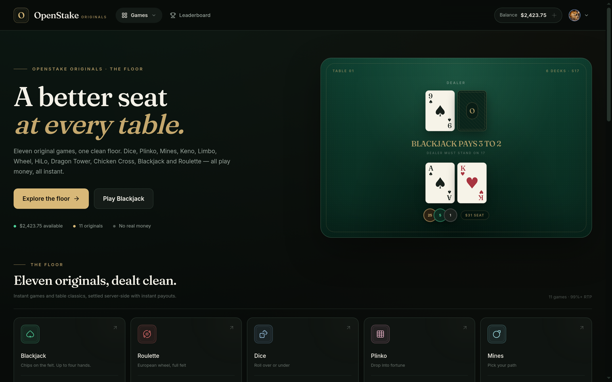
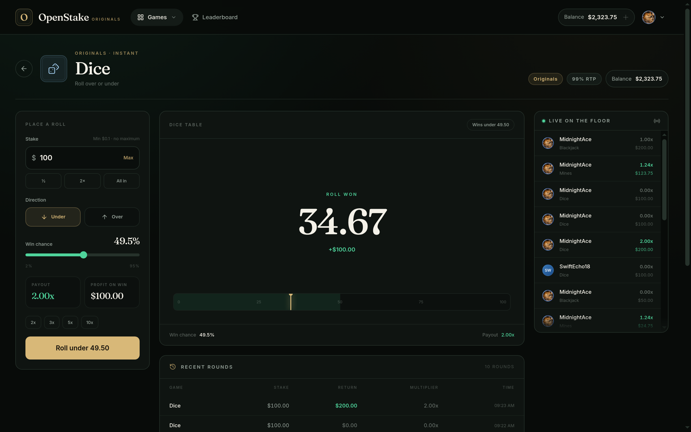
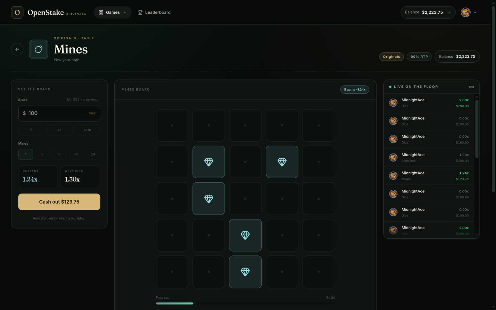
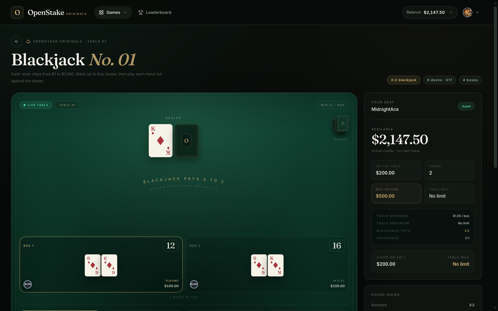
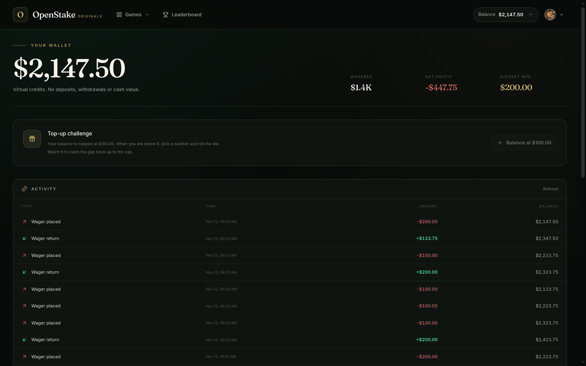
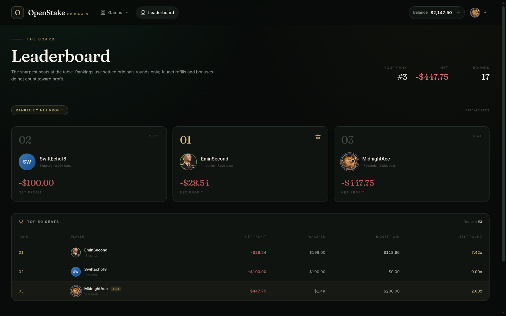
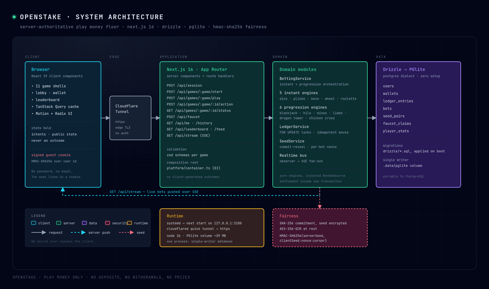
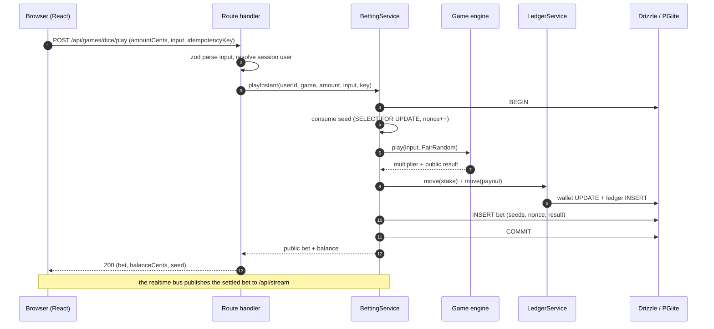
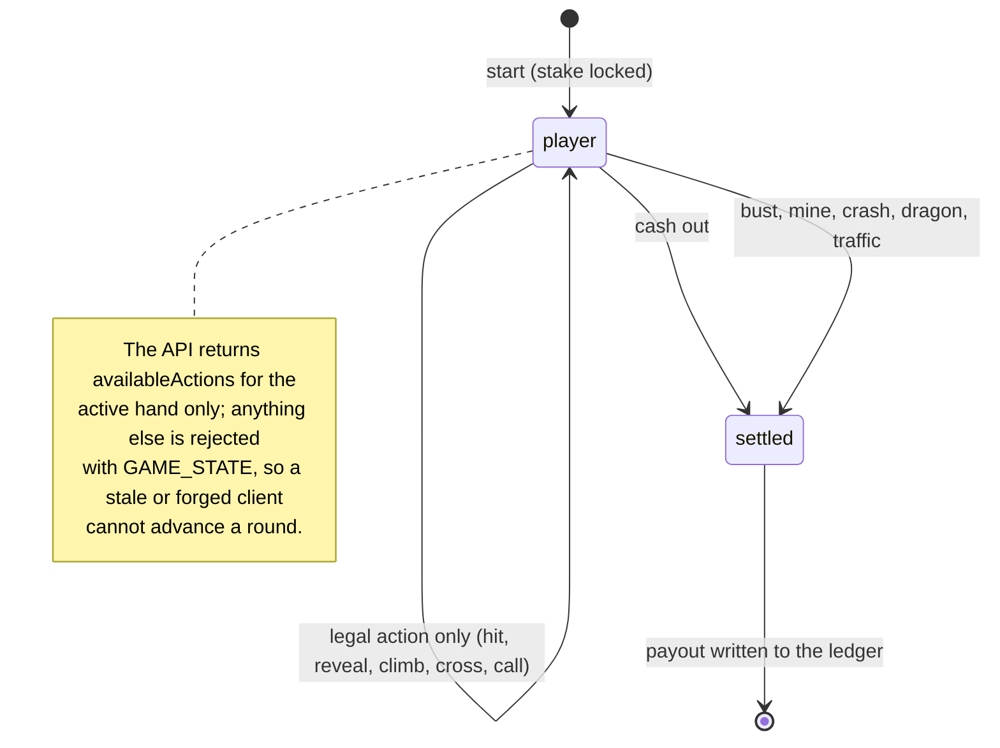
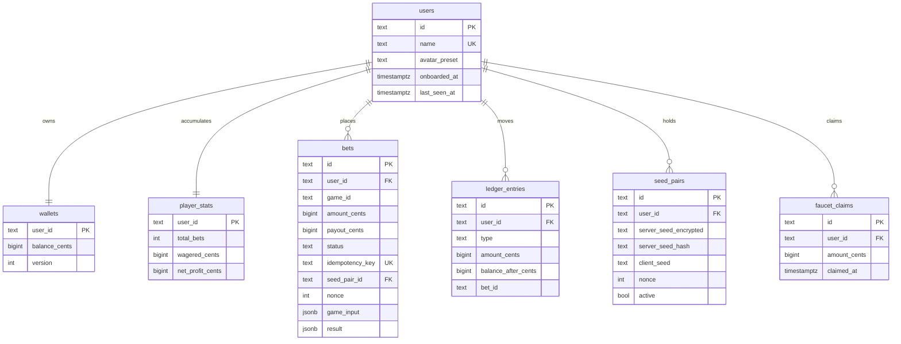

<div align="center">

# OpenStake

**A server-authoritative, play-money originals floor with the visual language of a private casino.**

[](https://nextjs.org)
[](https://react.dev)
[](https://www.typescriptlang.org)
[](https://orm.drizzle.team)
[](https://pglite.dev)
[](https://vitest.dev)



</div>

OpenStake is a full-stack reference implementation of a crypto-casino style **originals floor**: eleven
provably-drawn games sharing one wallet, one seed system and one design language. Every bet settles
server-side inside a database transaction, every outcome comes from an HMAC stream, and the client never
sees or generates a result.

There are **no deposits, no withdrawals, no real-money wagers and no prizes**. Balances are virtual
credits, seats are passwordless guests that live in a signed cookie, and the whole database is a single
PGlite directory that boots with `npm run dev`.

---

## Screenshots

<table>
  <tr>
    <td width="50%"><br/><sub><b>Dice</b> — pick a side and a win chance; the payout scales as <code>99 / chance</code>.</sub></td>
    <td width="50%"><br/><sub><b>Mines</b> — reveal gems, the multiplier compounds per safe tile, cash out before the board turns.</sub></td>
  </tr>
  <tr>
    <td width="50%"><br/><sub><b>Blackjack</b> — four boxes, six decks, S17, 3:2 naturals, doubles, splits and insurance.</sub></td>
    <td width="50%"><br/><sub><b>Wallet</b> — one ledger, one row per movement: wagers, returns, refunds and top-ups.</sub></td>
  </tr>
  <tr>
    <td colspan="2"><br/><sub><b>Leaderboard</b> — ranked by net profit from settled rounds only, with the floor's live feed beside it.</sub></td>
  </tr>
</table>

---

## The floor

Eleven originals share one wallet, one seed pair per player and one settlement path. Instant games settle in
a single request; table and progression games run an explicit state machine that accepts only the legal
actions it publishes.

| Game | Type | Structure | RTP* |
| --- | --- | --- | --- |
| **Blackjack** | progression | 6 decks · S17 · 3:2 · double · split · insurance | ~99.5% |
| **Dice** | instant | roll under/over, 2–95% win chance | 99.0% |
| **Mines** | progression | 25 tiles, 1–24 mines, `0.99 × C(25,k)/C(25−m,k)` | 99.0% |
| **Limbo** | progression | crash at `0.99 / (1 − r)`, cash out before it flies | 99.0% |
| **Keno** | instant | 40 numbers, 10 drawn, 1–10 picks, 3 risk levels | 99.0% |
| **HiLo** | progression | higher/lower on a live shoe, priced from the cards left | 99.0% |
| **Dragon Tower** | progression | nine floors of eggs and dragons | 99.0% |
| **Chicken Cross** | progression | twelve lanes, each safe step compounds | 99.0% |
| **Plinko** | instant | 8–16 rows, 3 risk levels, 15 paytables | 98.9–99.1% |
| **Wheel** | instant | 10–50 segments, 3 risk levels | 98.4–98.9% |
| **Roulette** | instant | single-zero European wheel, full felt | 97.3% |

<sub>*RTP computed from the shipped paytables with exact binomial / hypergeometric maths, not from marketing copy. The wheel sits below 99% because its multipliers are floored to two decimals after normalisation.</sub>

---

## Architecture

A thin browser that only sends intents and renders public state; one Next.js process that validates and
orchestrates; pure game engines behind a `RandomSource` seam; a single-writer, Postgres-compatible database
underneath.



### One bet, end to end



### Progression games: the server owns the state machine



### Data model



### Patterns

- **Strategy** — every instant game implements `InstantGameDefinition`, every table game implements
  `ProgressionEngine`; the betting service orchestrates both without game-specific branches.
- **Dependency injection** — `platform/container.ts` wires services; engines receive a `RandomSource`,
  wallets a `Clock` and an `IdGenerator`, so tests inject scripted decks and boards.
- **Repository + unit of work** — every wallet mutation runs in a Drizzle transaction with `FOR UPDATE`
  locks; a balance can only change through a ledger row.
- **State machine** — progression games expose explicit legal actions, phase data and settlement snapshots.
- **Observer** — the realtime event bus drives the SSE live feed without coupling engines to HTTP.
- **Design system** — Radix primitives and CVA variants keep the shell, tables and account pages coherent.

---

## Fairness

Each seat gets a server seed, its SHA-256 commitment and a client seed. A bet stores the seed pair, a
client-seed snapshot and the nonce it consumed, so a round can be replayed byte for byte:

```text
outcome stream = HMAC-SHA256(serverSeed, `${clientSeed}:${nonce}:${cursor}`)
```

- The server seed is 32 random bytes, encrypted at rest with AES-256-GCM, and never returned by the API.
- Only the hash is public while the pair is active — that commitment is what would make a later reveal
  checkable.
- The nonce is consumed in the same transaction that locks the seed row, so two concurrent bets can never
  share a random stream.
- Each digest yields eight `uint32` floats, and every engine draws only through `FairRandom`: there is no
  `Math.random()` anywhere in game logic.

**What is not there yet:** the reveal. `SeedService` exposes `rotate()` and `setClientSeed()`, but no route
or page wires them up, so a player cannot currently pull the old server seed and verify a past round in the
browser. Until that lands, the fairness is architectural rather than demonstrable. A `/fairness` page with
seed rotation, a client-seed field and a round-by-round verifier is the single most valuable next step for
this repo.

---

## Stack

| Layer | Choice |
| --- | --- |
| Framework | Next.js 16 App Router, React 19, TypeScript |
| Styling | Tailwind CSS 4 with a token-driven design system, Radix UI, CVA |
| Motion | Motion and Lucide icons |
| Data | Drizzle ORM + PGlite (Postgres dialect, zero setup), SQL migrations |
| State | TanStack Query, server components for first paint |
| Realtime | in-process event bus fanned out over SSE |
| Validation | zod schemas per game input and per action |
| Tests | Vitest (engine rules, paytables, blackjack settlement) |

---

## Getting started

```bash
npm install
cp .env.example .env.local
npm run dev
```

Generate the two secrets `.env.local` needs:

```bash
node -e "console.log(require('crypto').randomBytes(32).toString('base64url'))"  # SESSION_SECRET
node -e "console.log(require('crypto').randomBytes(32).toString('base64'))"     # SEED_ENCRYPTION_KEY
```

Open <http://localhost:3000>. The database is created in `.data/pglite` and migrations are applied on first
access — no Postgres, no Docker, no seed script.

| Command | What it does |
| --- | --- |
| `npm run dev` | dev server on :3000 |
| `npm run build` / `npm run start` | production build and server |
| `npm run lint` | eslint |
| `npm run typecheck` | `tsc --noEmit` |
| `npm test` | Vitest suite |
| `npm run db:generate` / `npm run db:migrate` | Drizzle migrations |

### Deploying it

The app is one Node process with a single-writer database, so the deploy is a unit file plus a tunnel:

```ini
[Service]
WorkingDirectory=/path/to/OpenStake
Environment=NODE_ENV=production
ExecStart=/usr/bin/node node_modules/next/dist/bin/next start -H 127.0.0.1 -p 3100
Restart=always
```

Point `cloudflared tunnel --url http://localhost:3100` at it, or put nginx in front for a stable hostname.
Beyond one instance, move PGlite to PostgreSQL and the realtime bus to a shared pub/sub — the schema and the
engines do not change.

---

## Project layout

```text
src/
  app/                     routes, route handlers, SSE stream
  components/
    casino/                shell, lobby, game tiles, live feed
    games/                 11 game UIs plus shared shell, controls, history
    ui/                    Radix-based design system primitives
    onboarding/            first-visit seat dialog
    avatars/               avatar picker with presets and photo upload
  modules/
    betting/               bet orchestration and settlement
    games/                 catalog, instant engines, progression engines, paytables
    wallet/                ledger, faucet and money primitives
    fairness/              seed pair lifecycle
    identity/              guest seats, profiles and avatar presets
    leaderboard/           ranking and transaction history
    realtime/              event bus and live bet feed
  platform/
    auth/                  signed guest sessions
    db/                    Drizzle schema, migrations, PGlite client
    container.ts           dependency-injection composition root
  lib/                     money, ids, errors, fairness primitives
docs/
  architecture.html        source of the architecture diagram
  screenshots/             README images
```

---

## Scope

Sportsbook, live-dealer video, third-party licensed content, payments and real-money wagering are
intentionally out of scope. This is a play-money product and a full-stack engineering showcase: the parts
worth reading are the settlement path, the seed lifecycle, the progression state machines and the paytable
maths.
